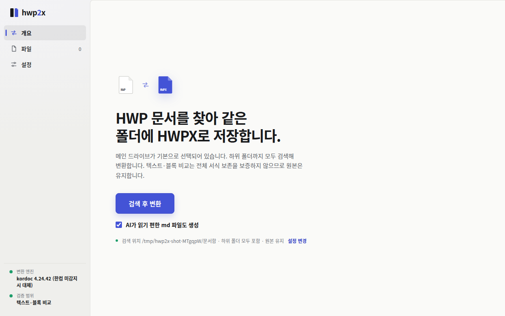
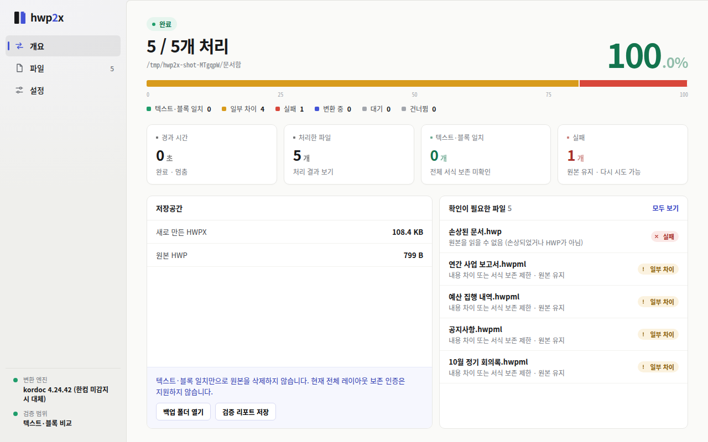
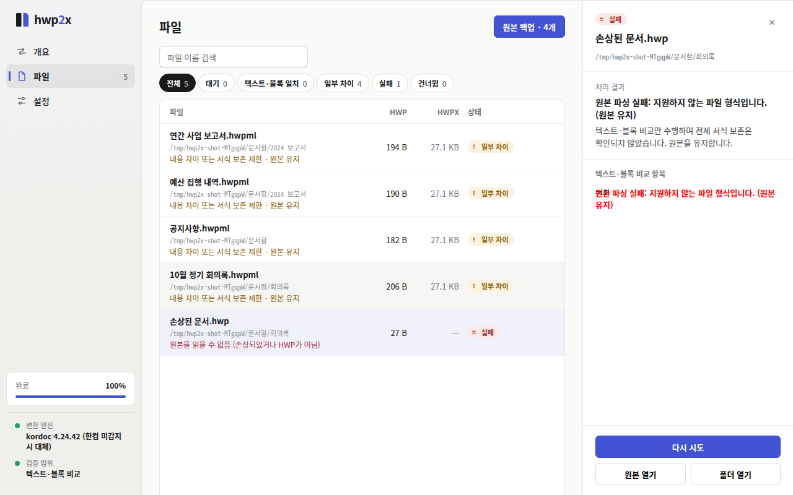
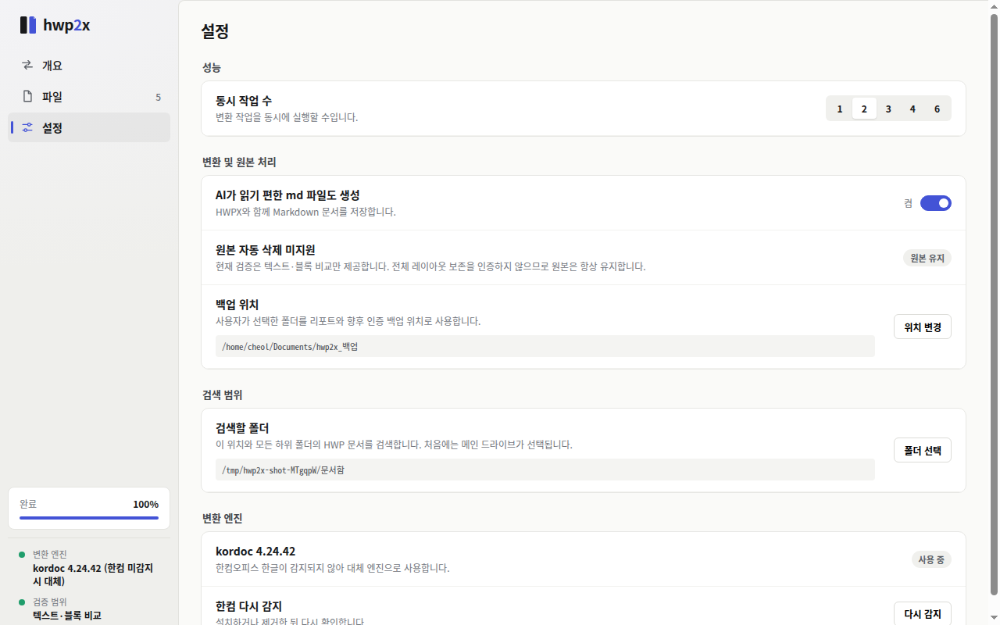

# hwp2x

<p align="center">
  
</p>
<p align="center">
  로컬 HWP 파일을 HWPX로 일괄 변환하는 Electron 데스크톱 앱
</p>

<p align="center">
  <a href="https://github.com/NomaDamas/hwp2x/releases/latest"></a>
  
  
</p>

## 스크린샷

| 시작 화면 | 변환 완료 | 파일 목록 | 설정 |
| :---: | :---: | :---: | :---: |
|  |  |  |  |

## 주요 기능

*   **일괄 HWPX 변환:** 메인 드라이브나 지정한 폴더 내의 HWP, HWPML 문서를 재귀적으로 검색하여 HWPX로 변환합니다.
*   **다중 엔진 지원:** Windows에서는 설치된 한컴오피스 한글을 우선 사용하고, 없을 경우 kordoc 대체 엔진을 사용하여 변환합니다.
*   **비교 검증:** 텍스트와 블록 내용을 비교하여 변환 결과를 검증합니다.
*   **안전한 원본 보호:** 변환 중 원본 문서를 절대 삭제하거나 덮어쓰지 않습니다. 필요 시 안전한 위치에 백업 복사본을 생성합니다.
*   **안정적인 이어하기:** 예기치 못한 종료 후에도 중단된 지점부터 다시 이어서 변환할 수 있습니다.
*   **디스크 부족 감지:** 작업 중 저장 공간이 부족하면 자동으로 안전 중단하여 데이터 손실을 방지합니다.
*   **Markdown 생성:** AI가 읽기 편한 Markdown 형식을 동시에 생성합니다(기본 활성화).

## 다운로드

[GitHub 최신 릴리스](https://github.com/NomaDamas/hwp2x/releases/latest) 페이지에서 다음 파일을 다운로드할 수 있습니다:

*   **hwp2x Setup 0.3.0.exe**: Windows 설치형
*   **hwp2x-0.3.0-portable-x64.exe**: Windows 무설치 포터블
*   **hwp2x_0.3.0_amd64.deb**: Linux(Debian/Ubuntu)용

## 작동 방식

1.  **검색:** 메인 드라이브(기본) 또는 선택한 폴더를 검색합니다.
2.  **변환:** 감지된 한컴오피스 한글 또는 대체 엔진을 통해 HWPX로 변환합니다.
3.  **검증:** 변환된 문서의 텍스트·블록 정보를 원본과 비교합니다.
4.  **출력:** HWPX와 Markdown 파일을 저장합니다. 원본은 삭제하지 않습니다.

## 사용과 문제 해결

- 설정에서 검색 폴더를 고른 다음 개요의 **검색한 파일 변환**을 누릅니다. MD 생성은 기본으로 켜져 있습니다.
- 한컴이 감지되지 않으면 설정 → 변환 엔진 → **Hwp.exe 선택**으로 설치 위치를 직접 지정할 수 있습니다. COM 등록이 없는 설치본은 사용 불가 사유를 표시합니다. 레지스트리를 임의로 수정하지 않습니다.
- 설정 → **로그 폴더 열기**에서 실행 환경·상태·오류 기록을 확인합니다. 로그는 사용자 데이터 폴더의 `logs/`에 저장되고 5MB 회전·7일 보존을 적용합니다.
- **작성 초안 열기**는 시스템 정보와 최근 오류를 담은 GitHub 이슈 작성 페이지를 엽니다. 자동 게시하지 않습니다. 문서명 등 민감한 내용이 없는지 확인하고 제출하세요.
- 종료가 오래 걸리면 기다리기 또는 강제 종료를 고를 수 있습니다. 강제 종료 시 마지막 진행 기록 이후의 작업은 재확인이 필요합니다.

## 검증 범위와 한계

- Linux 실제 Electron 창에서 메뉴, HWPX/MD 생성, 백업, 강제 종료 후 이어하기를 검사합니다. 실제 Windows와 한컴 2024 COM 변환은 별도 Windows 환경에서 확인이 필요합니다.
- 텍스트·블록 비교 통과가 모든 글꼴·쪽 배치·서식의 무손실을 보증하지 않습니다. 원본을 보존하고 중요한 문서는 결과를 직접 확인하세요.
- Windows 포터블은 매번 압축을 풉니다. ZIP 방식과 한국어·영어 리소스로 해제 부담을 줄였지만 설치형보다 시작이 느릴 수 있습니다.

## 개발·검증

```sh
npm ci
npm run typecheck
npm test
xvfb-run -a node electron/ipc-check.cjs
xvfb-run -a node electron/stability.test.cjs
npm run dist
```

`xvfb-run`은 Linux 가상 화면 검사에 사용합니다. Windows에서는 `npm start`로 실행할 수 있습니다.

## 라이선스

아직 라이선스가 지정되지 않았습니다.

## 기여 및 버그 리포트

버그나 기능 요청은 [GitHub Issues](https://github.com/NomaDamas/hwp2x/issues)를 이용해 주세요. 변환 과정에서 문제가 발생하면 로그 폴더를 확인하거나 버그 리포트 생성 기능을 활용할 수 있습니다.

*참고 오픈소스 README 구조: Excalidraw, LocalSend*