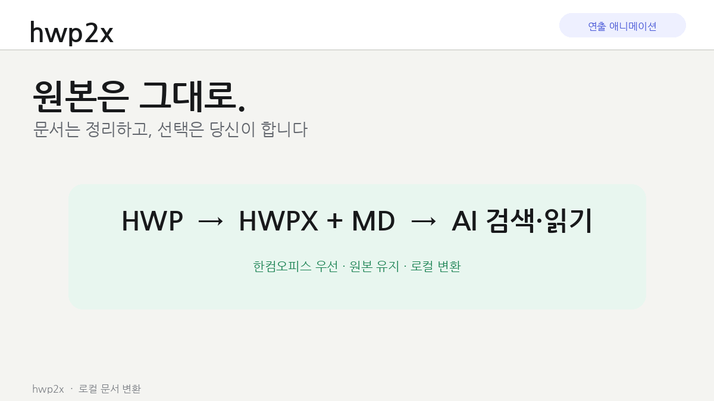
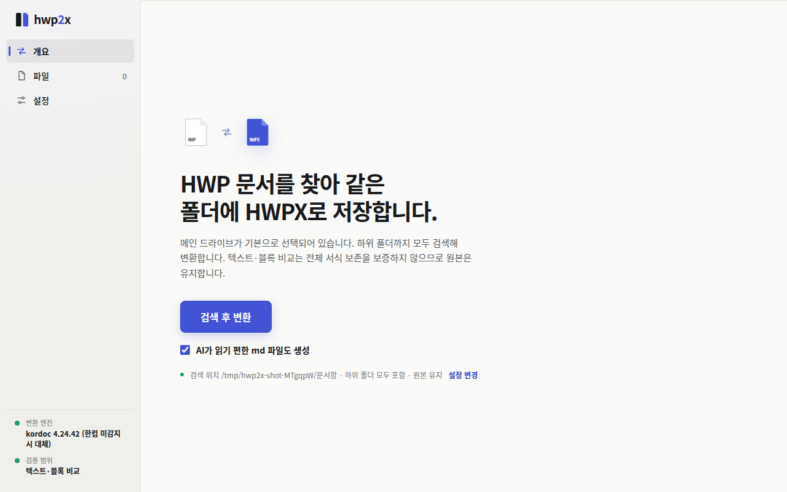
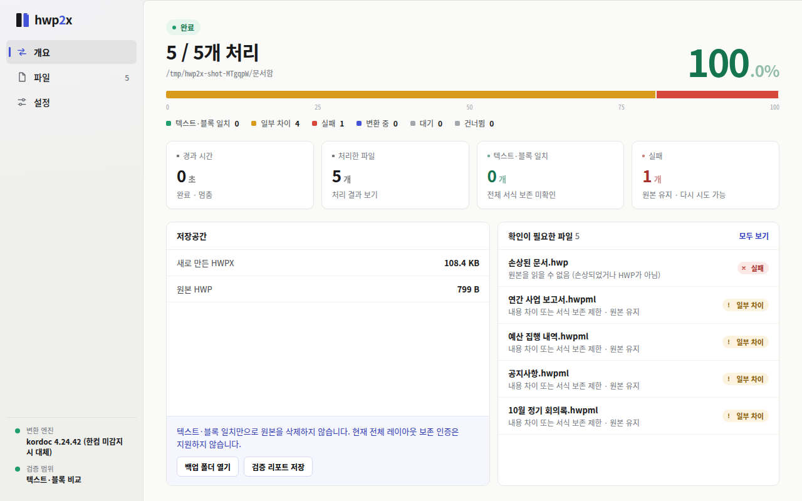
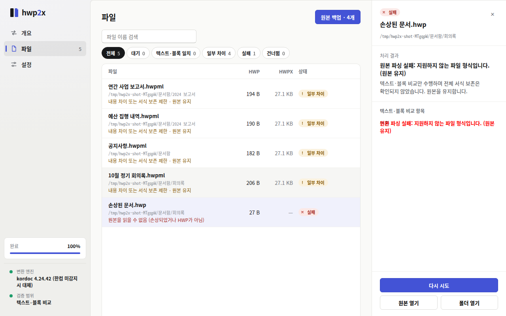
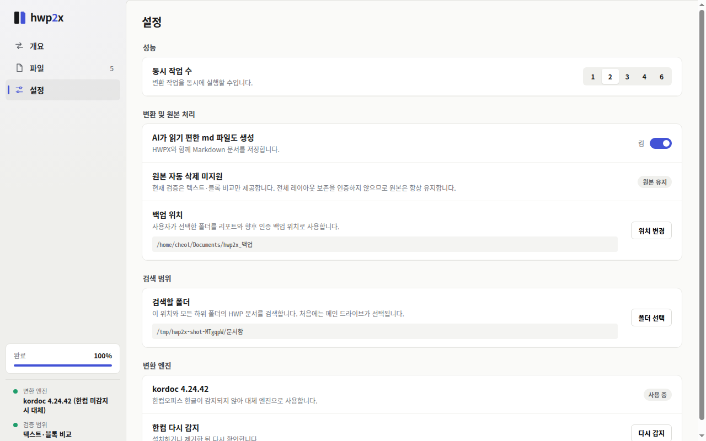

# hwp2x

<p align="center">
  
</p>

<h2 align="center">내 컴퓨터의 HWP를 HWPX와 Markdown으로.<br>AI가 찾고 읽기 좋은 문서로 정리합니다.</h2>

<p align="center">
  설치된 한컴오피스 한글을 우선 사용하고, 원본 HWP는 읽기 전용으로 보존합니다.
</p>

<p align="center">
  
</p>

<p align="center"><sub>위 GIF는 제품 흐름을 설명하는 연출 애니메이션입니다. 실제 Linux 패키지 앱 화면은 아래에서 확인할 수 있습니다.</sub></p>

<p align="center">
  <a href="https://github.com/NomaDamas/hwp2x/releases/latest"></a>
  
  
</p>

> **공무원 문서 정리용 로컬 변환 도구**
> 컴퓨터 곳곳의 HWP를 찾아 HWPX와 AI용 Markdown을 만들고, 원본은 건드리지 않습니다.

## 실제 앱 화면

| 시작 화면 | 변환 완료 | 파일 목록 | 설정 |
| :---: | :---: | :---: | :---: |
|  |  |  |  |

<sub>스크린샷은 Linux 패키지 앱의 실제 화면입니다. 실제 한컴오피스 한글 COM 변환과 Windows 트레이 동작은 Windows 환경에서 별도 확인이 필요합니다.</sub>

## 주요 기능

*   **일괄 HWPX 변환:** 메인 드라이브나 지정한 폴더 내의 HWP, HWPML 문서를 재귀적으로 검색하여 HWPX로 변환합니다.
*   **다중 엔진 지원:** Windows에서는 설치된 한컴오피스 한글을 우선 사용하고, 없을 경우 kordoc 대체 엔진을 사용하여 변환합니다.
*   **비교 검증:** 내장 kordoc 엔진으로 변환한 문서는 글자와 그림을 원본과 비교합니다. 한컴오피스 한글이 직접 저장한 HWPX는 비교 없이 통과로 처리합니다.
*   **안전한 원본 보호:** 원본 HWP에는 한 번도 쓰지 않습니다. 한글에는 임시 폴더의 읽기 전용 복사본만 열게 하고, 저장 전후로 원본이 바이트 단위로 그대로인지 확인해 다르면 실패로 알립니다.
*   **안정적인 이어하기:** 예기치 못한 종료 후에도 중단된 지점부터 다시 이어서 변환할 수 있습니다.
*   **디스크 부족 감지:** 작업 중 저장 공간이 부족하면 자동으로 안전 중단하여 데이터 손실을 방지합니다.
*   **Markdown 생성:** AI가 읽기 편한 Markdown 형식을 동시에 생성합니다(기본 활성화).

## 다운로드

현재 배포 후보는 [GitHub rc.6 릴리스](https://github.com/NomaDamas/hwp2x/releases/tag/v0.4.0-rc.6)에서 받을 수 있습니다.

*   **[hwp2x-0.4.0-rc.6-portable-x64.exe](https://github.com/NomaDamas/hwp2x/releases/download/v0.4.0-rc.6/hwp2x-0.4.0-rc.6-portable-x64.exe)**: Windows 10/11 64비트 무설치 포터블
*   **[hwp2x-0.4.0-rc.6-portable-ia32.exe](https://github.com/NomaDamas/hwp2x/releases/download/v0.4.0-rc.6/hwp2x-0.4.0-rc.6-portable-ia32.exe)**: Windows 10 32비트 무설치 포터블

서명되지 않은 시험판이므로 Windows 보안 경고가 표시될 수 있습니다. 실제 Windows·한컴오피스 한글 COM 변환, 승인창, 트레이 클릭, 재부팅 후 자동 재개는 이 Linux 환경에서 확인하지 않았습니다.

## 작동 방식

1.  **검색:** 메인 드라이브(기본) 또는 선택한 폴더를 검색합니다.
2.  **변환:** 감지된 한컴오피스 한글 또는 대체 엔진을 통해 HWPX로 변환합니다.
3.  **검증:** HWPX 구조를 확인합니다. 내장 엔진 결과는 글자·그림을 원본과 비교하고, 한글이 저장한 결과는 비교를 생략합니다.
4.  **출력:** HWPX와 Markdown 파일을 저장합니다. 원본은 삭제하지 않습니다.

## 사용과 문제 해결

- 앱을 열면 **특정 폴더 변환**에서 **폴더 선택**으로 폴더를 고르고 **N개 파일 변환**을 누릅니다. 하위 폴더까지 검색하고, MD 생성은 기본으로 켜져 있습니다.
- 변환 중에는 시작·폴더 선택이 잠기고 진행 막대와 처리 중인 파일이 보입니다. **일시정지** 후 **이어하기**로 같은 목록을 계속하거나 **중지**로 끝낼 수 있습니다. 중지·완료 화면에서 **다른 폴더 선택**이나 **이 폴더 다시 변환**을 바로 누를 수 있습니다. 이미 만든 HWPX는 덮어쓰지 않고 건너뜁니다.
- Windows 설치형과 포터블은 같은 실행 화면과 작업 제어 코드를 포함합니다. 일시정지 중 다른 폴더로 바꾸려면 먼저 **중지**한 뒤 **다른 폴더 선택**을 누릅니다.
- 한컴이 감지되지 않으면 설정 → 변환 엔진 → **Hwp.exe 선택**으로 설치 위치를 직접 지정할 수 있습니다. COM 등록이 없는 설치본은 사용 불가 사유를 표시합니다. 레지스트리를 임의로 수정하지 않습니다.
- 설정 → **다시 감지**를 누르면 결과가 버튼 바로 아래에 나옵니다. 새 설치본을 찾으면 목록에서 **이 버전 사용**으로 고를 수 있고, 새로 찾은 것이 없으면 지금 쓰는 엔진을 그대로 쓰거나 **Hwp.exe 선택**으로 직접 지정하라고 안내합니다. 쓰던 한컴이 사라졌으면 내장 kordoc 엔진으로 바뀐 사실을 알려 줍니다.
- 한글 2004 등 2010 이전 버전(제품 버전 8.0 미만)은 HWPX로 저장할 수 없어 사용 불가로 표시하고 kordoc으로 변환합니다.
- 파일 목록은 서버에서 100개씩 가져와 표시합니다. **이전 페이지 / 다음 페이지**, 이름 검색과 상태 필터를 사용할 수 있으며 변환은 전체 대상에 적용됩니다.
- 일시정지·중지는 누르는 즉시 안내가 바뀌고, 진행 중인 파일을 마친 뒤 멈춥니다. CPU 코어가 2개 이하인 PC는 동시 작업 1개로 시작합니다(설정에서 변경 가능).
- 설정 → 지원 → **로그 보기**를 누르면 상세 로그가 바로 보이고, **전체 복사**를 누르면 클립보드에 복사되어 메신저나 이슈에 그대로 붙여넣을 수 있습니다. 한컴 변환마다 실행 전 한글 목록, 새로 띄운 한글, 실패 사유가 기록됩니다.
- 한컴 변환은 동시 작업 수와 관계없이 한 번에 한 파일씩 진행합니다. 사용자가 열어 둔 한글 창은 변환에 쓰거나 닫지 않으며, 앱은 하나만 실행됩니다(다시 실행하면 기존 창이 앞으로 나옵니다).
- 한글 자동 변환 때 "한글을 이용하여 위 파일에 접근하려는 시도가 있습니다" 경고가 뜨지 않도록, 앱이 띄운 변환용 한글에만 파일 접근 승인 모듈(32·64비트)을 등록합니다. 현재 사용자 레지스트리(`HKCU\Software\HNC\HwpAutomation\Modules`)에만 기록하며 관리자 권한이 필요 없습니다.
- 설정 → **로그 폴더 열기**에서 실행 환경·상태·오류 기록을 확인합니다. 로그는 사용자 데이터 폴더의 `logs/`에 저장되고 5MB 회전·7일 보존을 적용합니다.
- **작성 초안 열기**는 시스템 정보와 최근 오류를 담은 GitHub 이슈 작성 페이지를 엽니다. 자동 게시하지 않습니다. 문서명 등 민감한 내용이 없는지 확인하고 제출하세요.
- 종료가 오래 걸리면 기다리기 또는 강제 종료를 고를 수 있습니다. 강제 종료 시 마지막 진행 기록 이후의 작업은 재확인이 필요합니다.
- **전체 자동 변환**은 접근 가능한 드라이브를 순회하며 최대 32개씩 한 파일씩 변환합니다. 기존 HWPX와 원본은 덮어쓰지 않으며, 자동 모드가 켜진 동안 특정 폴더 변환과 변환 설정은 잠깁니다.
- 신규 파일은 감시 이벤트와 30초 주기 재검색으로 찾습니다. 시스템 폴더·심볼릭 링크·백업 폴더는 제외하며 권한이 없는 폴더는 건너뜁니다. 감시기는 최대 128개로 제한하므로 감시되지 않는 폴더는 전체 재검색이 돌아올 때 발견합니다. 파일 크기·수정 시각이 1초 이상 안정된 뒤 처리합니다.
- **창을 닫아도 트레이에서 계속**을 켜면 자동 모드 실행 중 X는 숨김입니다. 트레이에서 창 열기·자동 중지·완전히 종료를 선택할 수 있습니다. **로그인하면 자동 변환 다시 시작**은 OS 로그인 시 숨김 상태로 재개합니다. 포터블은 원래 exe 경로를 등록하므로 파일을 이동한 뒤에는 옵션을 껐다 켜세요.
- 자동 변환은 한 바퀴 처리가 끝나면 **완료 · 감시 체제로 전환됨**을 표시합니다. 성공 결과 목록은 최근 배치이며, 미처리 기록은 별도로 최대 4,096개까지 저장하고 100개씩 보여 줍니다. 파일별 사유·대응 가이드와 **다시 작업** 버튼으로 재시도하고 대기/작업 중 경과를 볼 수 있습니다. 성공하면 미처리 목록에서 빠지며, 기존 HWPX를 덮어쓰지는 않습니다.
- 한컴 보안·암호·승인 창이나 응답 지연은 **처리하지 못함**으로 남기고 원본을 유지합니다. 감지 가능한 확인 창을 감시하며 무응답에는 120초 제한을 둡니다. 안전하게 변환용 한글을 회수한 경우 다음 파일로 넘어갑니다. 보안 수준을 낮추거나 경고를 임의 승인하지 말고, 원본을 한글에서 직접 확인한 뒤 재작업하세요.
- 사용자 문서나 소유권 변경이 감지되거나 변환용 한글의 종료를 확인하지 못하면 전체 작업을 안전 중단합니다. 사용자 문서를 저장하고 한글을 직접 종료한 뒤 앱을 다시 시작하세요. Windows에서 같은 한글 프로세스로 사용자 문서가 합쳐지는 모든 경우의 완전한 격리는 아직 보장하지 않습니다.
- 설정의 **안전하게 변환된 HWP 백업 후 삭제**는 현재 목록의 `변환됨` 중 앱의 원본·결과 해시 기록이 있는 `.hwp`만 대상으로 합니다. 일부 차이·실패·건너뜀과 과거 자동 변환 전체 이력은 포함하지 않습니다. 서식 무손실 인증은 아니며 한컴 결과는 내용 비교를 생략합니다.
- 동의 후 원래 파일 이름을 제거하고 같은 폴더의 고유 숨김 안전보관 경로(`original.bin`)와 지정 백업 폴더의 검증된 복사본을 유지합니다. 데이터 유실 방지를 위한 **원래 위치 정리**이며 영구 삭제나 디스크 공간 확보 기능은 아닙니다.
- 처리 개수와 진행률을 표시하며 **취소하고 복구**, 완료 후 **원래 위치로 복구**를 제공합니다. 충돌 파일은 덮어쓰지 않습니다. 복구 기록·안전보관본·백업은 직접 지우지 마세요. 중단 기록은 재시작 시 복구하며, 충돌이나 손상은 오류로 남기고 복구를 다시 시도할 수 있습니다. 이전 작업을 복구하기 전에는 다음 정리 작업을 시작할 수 없습니다.

## 검증 범위와 한계

- Linux 실제 Electron 창에서 메뉴, HWPX/MD 생성, 백업, 강제 종료 후 이어하기를 검사합니다. 실제 Windows와 한컴 2024 COM 변환은 별도 Windows 환경에서 확인이 필요합니다.
- Linux 패키지에서 3,000개 목록의 100행 페이지, 다중 검색 위치·신규 HWP 감지, 트레이 숨김 중 변환, 로그인 시작 인자 재개와 다른 창 타이핑 중 포커스를 검사했습니다. 실제 OS 재부팅과 Windows 한컴 생성 순간의 포커스는 미검증입니다. 한컴 소유 창을 숨기고 보안 모듈 실패 시 문서를 열지 않지만, 모든 Windows 버전에서 포커스 탈취가 전혀 없다고 보장하지 않습니다.
- 로컬 빌드의 Windows x64·ia32 설치형과 포터블에서 추출한 앱 코드가 같은지 확인했습니다. 이는 Windows 실행 검증을 대신하지 않습니다. Windows 10/11 PC 또는 가상 머신에서 설치형의 설치·실행과 포터블의 압축 해제·실행을 각각 확인하고, 폴더 선택 → 변환 → 일시정지 → 이어하기 → 중지 → 다른 폴더 선택 → 완료 후 재실행을 검사해야 합니다. 32비트 Windows 지원 확인에는 Windows 10 32비트 환경이 별도로 필요합니다.
- 텍스트·블록 비교 통과가 모든 글꼴·쪽 배치·서식의 무손실을 보증하지 않습니다. 원본을 보존하고 중요한 문서는 결과를 직접 확인하세요.
- Windows 포터블은 매번 압축을 풉니다. ZIP 방식과 한국어·영어 리소스로 해제 부담을 줄였지만 설치형보다 시작이 느릴 수 있습니다.
- Windows 7·8·8.1에서는 실행되지 않습니다. 이 앱이 쓰는 Electron 41은 Windows 10 이상만 지원하며(Electron 23부터 7·8 지원 종료), 32비트 설치형·포터블도 Windows 10 32비트 이상이 필요합니다.
- 32비트판(`hwp2x Setup 0.3.0-ia32.exe`, `hwp2x-0.3.0-portable-ia32.exe`)은 Windows 10 32비트 PC용입니다. 실제 32비트 Windows에서는 아직 실행해 보지 않았습니다. Linux의 Wine에서는 32비트판과 64비트판 모두 Electron 41이 화면을 띄우기 전에 멈춰 Wine으로는 확인할 수 없으므로, 배포 전에 Windows 10 32비트 실기기나 가상 머신에서 메뉴와 변환을 확인해야 합니다.

## 개발·검증

```sh
npm ci
npm run typecheck
npm test
xvfb-run -a node electron/ipc-check.cjs
xvfb-run -a node electron/stability.test.cjs
npm run dist
```

`xvfb-run`은 Linux 가상 화면 검사에 사용합니다. Windows에서는 `npm start`로 실행할 수 있습니다.

## 라이선스

아직 라이선스가 지정되지 않았습니다.

## 기여 및 버그 리포트

버그나 기능 요청은 [GitHub Issues](https://github.com/NomaDamas/hwp2x/issues)를 이용해 주세요. 변환 과정에서 문제가 발생하면 로그 폴더를 확인하거나 버그 리포트 생성 기능을 활용할 수 있습니다.

*참고 오픈소스 README 구조: Excalidraw, LocalSend*