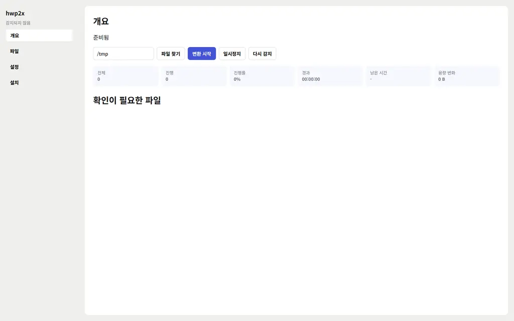

# hwp2x

로컬 컴퓨터의 HWP 파일을 찾아 같은 폴더에 HWPX로 저장하는 설치형 프로그램입니다. 웹브라우저가 아니라 프로그램 창에서 실행합니다.

## 받을 파일

GitHub Releases에서 운영체제에 맞는 파일을 받습니다.

| 환경 | 파일 | 지원 |
|---|---|---|
| Windows 10 이상 | `hwp2x-setup.exe` | 한글 2014, 2018, 2020, 2022 |
| Debian, Ubuntu | `hwp2x_0.1.0_amd64.deb` | 화면 확인과 패키징. 실제 변환은 Windows와 한글 필요 |

설치 파일을 만드는 명령은 `packaging/build.sh`입니다.

## 사용 방법

1. 설치 후 시작 메뉴 또는 앱 목록에서 `hwp2x`를 실행합니다.
2. 개요에서 검색 폴더를 확인하고 `파일 찾기`, `변환 시작`을 누릅니다.
3. 진행 수, 진행률, 경과 시간, 남은 시간, 용량 변화를 확인합니다.
4. 차이 또는 실패한 파일은 개요의 확인 목록에서 원인을 봅니다.
5. 검증에서 차이가 없는 원본만 파일 화면의 `무손실 원본 백업 후 삭제`로 백업 폴더에 옮깁니다.

설정에서는 동시 작업 수, 백업 위치, 자동 백업을 저장합니다.

자세한 절차는 [사용 매뉴얼](docs/manual.md)에 있습니다. 포함된 오픈소스 라이선스는 [오픈소스 고지](THIRD_PARTY_NOTICES.md)를 확인합니다.
